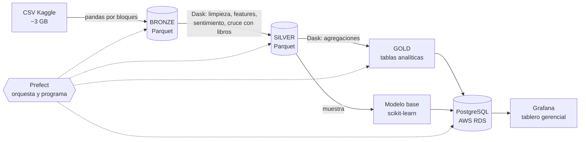

# Amazon Books Reviews · Proyecto Big Data (CRISP-DM)

Análisis de ~3 millones de reseñas de libros de Amazon para identificar **qué factores se
asocian con la insatisfacción del lector**, con un pipeline recurrente en **Prefect**,
procesamiento distribuido con **Dask**, resultados en **PostgreSQL (AWS RDS)** y un tablero
gerencial en **Grafana**.

* **Dataset:** [Amazon Books Reviews – Kaggle](https://www.kaggle.com/datasets/mohamedbakhet/amazon-books-reviews)
  (`Books_rating.csv` ≈ 2.7 GB + `books_data.csv` ≈ 180 MB)
* **Unidad de análisis:** la reseña individual
* **Variable objetivo:** `is_negative` = 1 si el puntaje es ≤ 2 estrellas

## Arquitectura



Solo la capa GOLD (unos cientos de KB) se sube a AWS.

## Estructura

```
├── config.yaml              # rutas, umbrales y perfiles de Dask (workers / memoria)
├── src/
│   ├── convert.py           # CSV -> Parquet incremental (manifiesto)
│   ├── transform.py         # limpieza + features (funciones pandas aplicadas con Dask)
│   ├── aggregations.py      # tablas GOLD
│   ├── quality.py           # perfil de calidad de datos
│   ├── model.py             # modelo base: ¿se puede anticipar una reseña negativa?
│   ├── load.py              # carga a PostgreSQL / AWS RDS
│   └── dask_benchmark.py    # comparación de configuraciones de Dask
├── flows/
│   ├── etl_flow.py          # flujo de Prefect (6 tareas)
│   └── serve_schedule.py    # programación diaria del flujo
├── notebooks/
│   ├── 01_EDA_dask.ipynb            # comprensión de los datos
│   ├── 02_benchmark_dask.ipynb      # workers y memoria por worker
│   └── 03_resultados_y_modelo.ipynb # hallazgos para el documento
├── grafana/dashboard_amazon_books.json   # tablero listo para importar
├── sql/                     # usuario de solo lectura y consultas de Grafana
├── scripts/make_sample_data.py           # datos sintéticos para probar rápido
├── tests/test_pipeline.py
└── docs/                    # guías de AWS, Grafana y plan del proyecto
```

## Puesta en marcha

```bash
# 1. Entorno
python -m venv .venv && source .venv/bin/activate      # Windows: .venv\Scripts\activate
pip install -r requirements.txt

# 2. Prueba rápida con datos sintéticos (2 minutos)
python scripts/make_sample_data.py --rows 200000 --out data/raw
pytest -q
python -m flows.etl_flow          # sin .env usa SQLite local: data/gold/analytics.db

# 3. Datos reales (borrar antes los sintéticos: rm -rf data/)
kaggle datasets download -d mohamedbakhet/amazon-books-reviews -p data/raw --unzip
python -m flows.etl_flow --force   # con DB_URL en .env carga directo a AWS RDS

# 4. Comparar configuraciones de Dask
python -m src.dask_benchmark --profiles A B C

# 5. Interfaz de Prefect y programación diaria
prefect server start               # http://127.0.0.1:4200
python -m flows.serve_schedule
```

Mientras corre algo con Dask, el dashboard está en http://localhost:8787 (tomar capturas).

## Cumplimiento de la rúbrica

| Punto | Dónde está |
|---|---|
| a. Dataset, objetivo y unidad de análisis | este README, `notebooks/01_EDA_dask.ipynb` (encabezado) |
| b. EDA: tipos, tendencia central, distribuciones, patrones, variable objetivo | `notebooks/01_EDA_dask.ipynb` |
| c. Análisis preliminar e información de contexto | `01_EDA_dask.ipynb` sección 16, tabla `data_quality` |
| d. Flujo recurrente y escalable en Prefect | `flows/etl_flow.py`, `flows/serve_schedule.py` |
| e. Dask con ≥ 2 configuraciones de workers y memoria | `config.yaml` (perfiles A/B/C), `src/dask_benchmark.py`, `02_benchmark_dask.ipynb` |
| f. Base de datos en AWS con resultados | `src/load.py`, `docs/guia_aws_rds.md` |
| g. Visualización gerencial en Grafana | `grafana/dashboard_amazon_books.json`, `docs/guia_grafana.md` |
| h. Conclusiones | `03_resultados_y_modelo.ipynb` + documento |
| i–k. Documento APA/IEEE con evidencias | Google Docs/Word compartido (ver `docs/plan_proyecto.md`) |
| l. Notebooks y scripts en GitHub | este repositorio |

## Notas de diseño
* **¿Por qué no `dd.read_csv` directo?** Las reseñas tienen saltos de línea dentro del texto;
  partir el CSV por bytes corrompe filas. Se convierte una vez a Parquet con pandas por bloques
  y desde ahí todo se procesa en paralelo con Dask.
* **Recurrente:** el manifiesto `data/bronze/_manifest.json` registra los CSV procesados. Un CSV
  nuevo en `data/raw` con el mismo esquema se procesa en la siguiente corrida.
* **Sin fuga de información:** el modelo no usa variables derivadas del puntaje.
